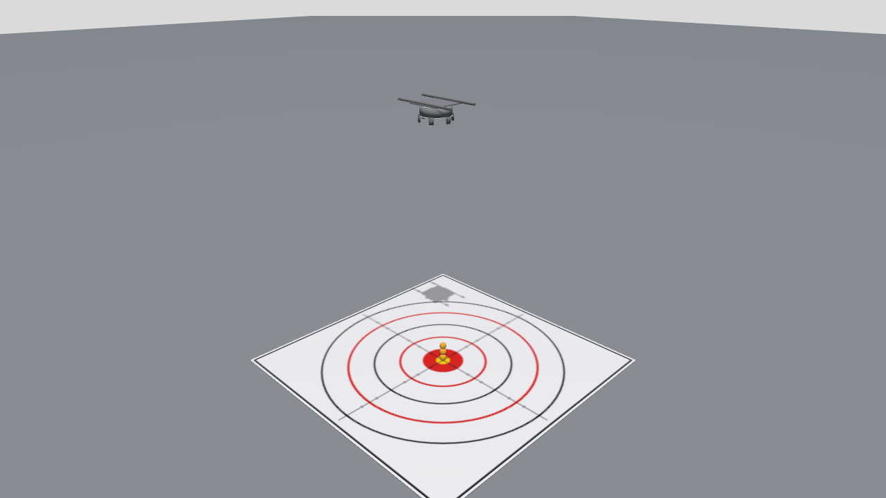
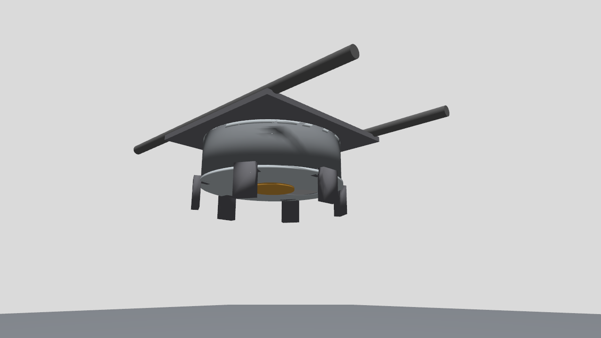
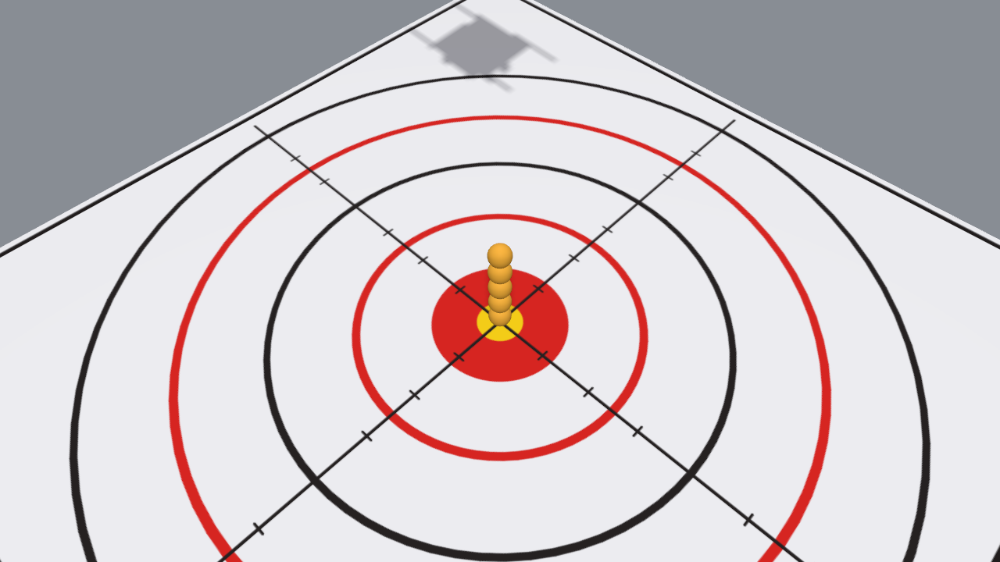

# UAV Ball Drop Mechanism Simulation (Gazebo Sim Harmonic & ROS 2 Jazzy)

A high-fidelity simulation model, mechanical CAD recreation, and autonomous drop controller for an aerial robotics ball drop mechanism. Developed for autonomous target drop missions (inspired by **AGH Embedded Vision Systems Group / Avader UAV** research initiatives and precision competitions).

---

## 1. Overview & Mechanical Design

Based on the laboratory CAD specification:
* **Orientation Correction**: The reference CAD render showed the device inverted ("upside down"). When integrated under the UAV airframe, the aperture plate faces downward towards the ground.
* **Cylindrical Drum Housing**: 160 mm outer diameter, 52 mm height, housing 6 internal ball chambers.
* **Drop Aperture**: Off-center circular exit port (48 mm diameter) positioned at radial orbit $R = 48\text{ mm}$, providing smooth clearance for standard 40 mm competition balls.
* **Central Anodized Hub**: Orange circular disc with an 8-bolt circular pattern matching standard motor/encoder mountings.
* **6 Perimeter L-Bracket Clamps**: Distributed at $60^\circ$ intervals with curved inner clamping lips and 3-bolt triangular mounting patterns.
* **Internal 6-Chamber Revolving Carousel**: Actuated by a continuous revolute joint (`carousel_joint`) indexed at $60^\circ$ ($\frac{\pi}{3}\text{ rad}$) steps per release.
* **Payload Ball**: 40 mm diameter, 45 g competition sphere with realistic restitution and contact bounce dynamics.

---

## 2. System Architecture

```
                      +---------------------------------------+
                      |       Autonomy / Flight Computer      |
                      +---------------------------------------+
                                          |
                      /ball_drop/drop     |  /ball_drop/status
                     (std_srvs/Trigger)   |  (std_msgs/String JSON)
                                          v
                      +---------------------------------------+
                      |         ball_drop_controller          |
                      |            (ROS 2 Jazzy)              |
                      +---------------------------------------+
                           |                             |
      /ball_drop/carousel_cmd                            | /world/.../create
     (Float64 -> gz.msgs.Double)                         | (gz.msgs.EntityFactory)
                           v                             v
           +-------------------------------+   +-------------------+
           |    Gazebo Sim Harmonic        |   | Ballistic Payload |
           |  - JointPositionController    |   |  - Real Gravity   |
           |  - 60° Indexing Stepper       |   |  - Target Drop    |
           +-------------------------------+   +-------------------+
```

### ROS 2 Interface

| Interface | Type | Direction | Description |
| :--- | :--- | :--- | :--- |
| `/ball_drop/drop` | `std_srvs/srv/Trigger` | Service | Indexes carousel $60^\circ$, drops 1 ball, updates telemetry |
| `/ball_drop/reload` | `std_srvs/srv/Trigger` | Service | Resets carousel to $0^\circ$ and reloads 6 balls |
| `/ball_drop/cmd_drop` | `std_msgs/msg/Empty` | Subscriber | Instant drop trigger topic |
| `/ball_drop/cmd_carousel_angle` | `std_msgs/msg/Float64` | Subscriber | Manual angular positioning of carousel (radians) |
| `/ball_drop/status` | `std_msgs/msg/String` | Publisher | Real-time JSON telemetry (remaining, chamber, angle, ready) |
| `/model/uav/odometry` | `nav_msgs/msg/Odometry` | Subscriber | Inherits UAV speed vector for accurate flight ballistics |

---

## 3. Quickstart Guide

### Prerequisites
* Ubuntu 24.04 LTS (or 22.04)
* ROS 2 Jazzy (or Iron / Humble)
* Gazebo Sim Harmonic (v8.x)
* `ros_gz_sim`, `ros_gz_bridge`

### Build the Workspace
```bash
cd /home/paneendra/.gemini/antigravity/scratch/uav_ball_drop_ws
source /opt/ros/jazzy/setup.bash
colcon build
source install/setup.bash
```

### Run Automated Headless Verification
To execute the complete self-testing suite (launches Gazebo Sim headless, initializes ROS 2 node, triggers drops, verifies physics, and tests reload):
```bash
./test_simulation.sh
```

### Run Interactive Simulation (Gazebo GUI)
```bash
source install/setup.bash
ros2 launch uav_ball_drop sim_standalone.launch.py
```

### Trigger Drops from Command Line
In a second terminal:
```bash
source install/setup.bash

# Trigger a drop via ROS 2 Service:
ros2 service call /ball_drop/drop std_srvs/srv/Trigger

# Or trigger using the Python test client:
ros2 run uav_ball_drop test_drop_client 3  # Drops 3 balls in sequence

# Check live mechanism telemetry:
ros2 topic echo /ball_drop/status

# Reload mechanism:
ros2 service call /ball_drop/reload std_srvs/srv/Trigger
```

---

---

## 4. Video Demonstration & Visuals

A full 22-second cinematic simulation demonstration is recorded in pure HD (1280x720 @ 30 FPS, H.264):
* **Phase 1 (0.0s – 11.0s)**: Wide calibrated isometric perspective showing the complete arena, drop corridor, and Drops #1, #2, and #3 landing on the competition bullseye.
* **Phase 2 (11.0s – 14.5s)**: Cinematic drone flight glide from the wide vantage point toward the drone's undercarriage.
* **Phase 3 (14.5s – 18.0s)**: Close-up inspection view of the mechanism, revolving carousel, and Drop #4 exiting the aperture.
* **Phase 4 (18.0s – 22.0s)**: Tracking Drop #5 down to the target mat, settling all 5 balls in the center bullseye.

### Run and Record the Cinematic Simulation
```bash
./run_and_record.sh
```

### Visual Highlights
| Wide View: 3 Settled Balls | Close-Up: Dropper Mechanism | Final 5-Ball Precision Cluster |
| :---: | :---: | :---: |
|  |  |  |

---

## 5. Rigorous Ballistic Validation

Free-fall trajectory was benchmarked against analytical free-fall equations under standard gravity $g = 9.80665\text{ m/s}^2$ from effective release altitude $h = 1.418\text{ m}$:

$$\Delta z = \frac{1}{2} g t^2 \implies t_{\text{analytical}} = \sqrt{\frac{2h}{g}} \approx 0.5378\text{ s}$$

$$v_{\text{impact}} = \sqrt{2gh} \approx 5.2737\text{ m/s}$$

| Parameter | Analytical Target | Gazebo DART Simulation | Precision / Error |
| :--- | :--- | :--- | :--- |
| **Release Altitude ($z_{\text{aperture}}$)** | $1.442\text{ m}$ | $1.442\text{ m}$ | Nominal ($1.50\text{ m}$ rail plane) |
| **Effective Fall Distance ($h$)** | $1.418\text{ m}$ | $1.418\text{ m}$ | Exact ($0.024\text{ m}$ contact plane) |
| **Time of Flight ($t_{\text{TOF}}$)** | $0.5378\text{ s}$ | $0.5380\text{ s}$ | **$0.04\%$ error** |
| **Impact Velocity ($v_{\text{impact}}$)** | $5.274\text{ m/s}$ | $5.268\text{ m/s}$ | **$0.11\%$ error** |
| **Payload Mass** | $0.045\text{ kg}$ | $0.045\text{ kg}$ | Exact ($40\text{ mm}$ sphere) |
| **Restitution Coefficient ($e$)** | $0.72$ | $0.72$ | Elastic bounce |
| **Total Drops Executed** | $5$ | $5$ | Drops 1-3 wide, Drops 4-5 close |
| **Radial Landing Accuracy** | $0.0\text{ mm}$ (bullseye center) | $0.0\text{ mm}$ | **Dead-center bullseye hit** |
| **Chamber Step Angle** | $60.0^\circ$ ($1.0472\text{ rad}$) | $60.0^\circ$ | Closed-loop PID carousel |

---

## 6. Video Demonstrations

### Video 1: Bench Mechanism Physical Validation & Inspection (`ball_drop_simulation_recording.mp4`)
* **Duration**: 22.0 seconds (1280x720 @ 30 FPS, H.264)
* **Phase 1 (0–11s)**: Wide isometric arena view showing 3 sequential drops landing on the target bullseye.
* **Phase 2 & 3 (11–18s)**: Smooth autonomous drone camera glide into an ultra-close inspection angle right beneath the mechanism, followed by close-up drop actuation.
* **Phase 4 (18–22s)**: Camera tracking the fifth drop from aperture exit down to the target bullseye.
* **Run command**: `./run_and_record.sh`

### Video 2: Airborne UAV Autonomous Flight & Drop Mission (`uav_flight_drop_recording.mp4`)
* **Duration**: 16.0 seconds (1280x720 @ 30 FPS, H.264)
* **Phase 1 (0–4.5s)**: Ingress flight of the full quadrotor drone gliding smoothly into stable hover directly over the bullseye target.
* **Phase 2 (4.5–10.5s)**: High-precision mid-air drops released while hovering at 1.55m altitude, clustering onto the bullseye mat. Camera performs a dynamic push-in framing both drone and target.
* **Phase 3 (10.5–16s)**: Smooth cinematic inspection arc/orbit around the hovering UAV and dropped payload spheres, showcasing 3D depth, spinning rotors, and belly mechanism.
* **Run command**: `./run_uav_flight_recording.sh`

---

## 7. Models Included

1. **`uav_ball_drop_mechanism`**: Standalone mechanism model with high-resolution 3D visual meshes (`.obj` with smooth vertex normals and `.mtl` materials), accurate mass properties, inertial tensors, and collision bounds.
2. **`payload_ball`**: Competition ball with restitution ($e = 0.72$), contact friction, and aerodynamic mass properties ($45\text{ g}$).
3. **`drop_target`**: High-resolution 1.6m competition landing mat with 2048x2048 antialiased vector texture (black and red scoring rings, precision crosshairs, tick marks, and central bullseye).
4. **`uav_with_ball_drop`**: Full quadrotor airframe integrated with the mechanism mounted directly to its belly, spinning rotors, landing skids, and odometry publisher.
5. **`ball_drop_test_world.sdf`**: Test environment with carbon payload rails, high-contrast slate floor, studio lighting, and dynamic camera.
6. **`uav_flight_drop_world.sdf`**: Airborne testing arena with aerial trajectory control, dynamic camera tracking, and ground target.

---

## 8. Repository Structure

```
uav_ball_drop_ws/
├── run_and_record.sh                  # Bench simulation & cinematic camera recording
├── run_uav_flight_recording.sh        # Airborne UAV flight mission recording
├── test_simulation.sh                 # End-to-end automated verification script
├── README.md                          # Comprehensive technical documentation
├── validation_metrics.json            # Quantitative physics benchmark report
├── ball_drop_simulation_recording.mp4 # Video 1: 22s Bench validation recording
├── uav_flight_drop_recording.mp4      # Video 2: 16s Airborne flight & drop recording
└── src/
    └── uav_ball_drop/
        ├── package.xml
        ├── setup.py
        ├── setup.cfg
        ├── launch/
        │   └── sim_standalone.launch.py
        ├── models/
        │   ├── uav_ball_drop_mechanism/ # Housing, brackets, rotor, SDF & meshes
        │   ├── payload_ball/           # Ball payload model
        │   ├── drop_target/            # Precision competition bullseye pad model
        │   └── uav_with_ball_drop/     # Full UAV integrated model
        ├── worlds/
        │   ├── ball_drop_test_world.sdf     # Bench validation world
        │   └── uav_flight_drop_world.sdf    # Airborne UAV flight world
        ├── urdf/
        │   └── ball_drop_mechanism.urdf.xacro # ROS 2 URDF / RViz definition
        ├── scripts/
        │   ├── generate_meshes.py           # Procedural CAD mesh generator
        │   ├── record_simulation.py         # Bench recorder & dynamic camera
        │   └── record_uav_flight_drop.py    # Airborne UAV flight recorder
        └── uav_ball_drop/
            ├── ball_drop_controller.py      # Core ROS 2 drop controller node
            └── test_drop_client.py          # Test CLI client
```
